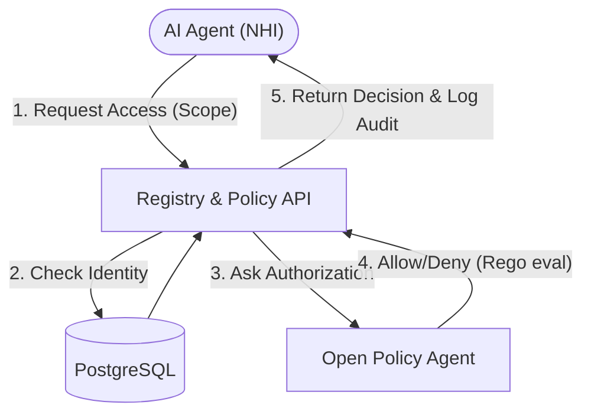
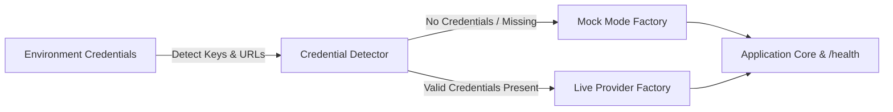
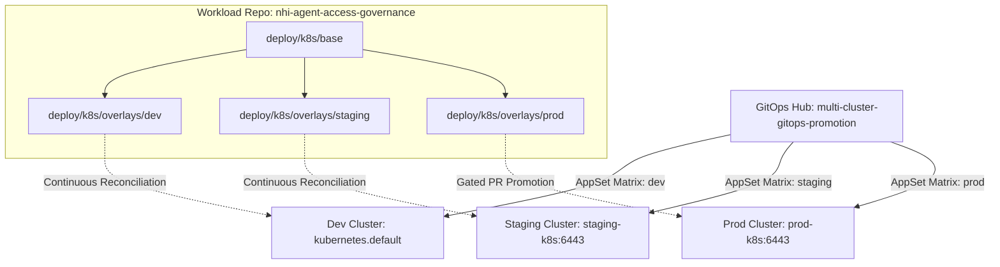

# Architecture — nhi-agent-access-governance
> Last updated: 2026-08-29 | Maturity: Partial Prototype
> _NHI access governance platform with OPA._

## System Diagram
The following Mermaid.js sequence diagram maps the core workflow and interactions:

## Component Table

| Component | File | Responsibility | Tech |
|---|---|---|---|
| Registry API | `registry-api/` | Main entrypoint | Node.js |
| Policy Engine | `policy/` | Authz rules | Rego / OPA |
| Database | `docker-compose.yml` | Identity store & Audit log | PostgreSQL |
| Dashboard | `dashboard/` | UI for analysts | React |

## Dependency Honesty Table

| Dependency | Status | Notes |
|---|---|---|
| OPA | **Real** | Used as the live Policy Decision Point. |
| PostgreSQL | **Real** | Used for identities and audit logs. |
| Target System | **Simulated** | API intercepts requests but doesn't forward to a real Kubernetes cluster. |

## The NHI Lifecycle Model

This project demonstrates a zero-trust model for managing NHIs.

### 1. Registration & Scoping
Every AI Agent, bot, or service account must be registered in the **NHI Registry**. 
- It is assigned an **Owner** (for accountability).
- It is granted specific, least-privilege **Scopes** (e.g., `read:kubernetes_pods`, not `*:*`).
- It has a definitive **Expiry** (to prevent credential hoarding/drift).

### 2. Request & Policy Evaluation
When an AI agent requests an action (e.g., reading a database, or fetching kubernetes secrets):
- The agent authenticates (using short-lived OIDC or mTLS credentials).
- The registry API acts as a Policy Enforcement Point (PEP).
- It queries the **Policy Engine (Open Policy Agent - OPA)**, passing the agent's assigned scopes and the requested action/resource.
- OPA evaluates the request against the declarative Rego policies (Policy Decision Point).

### 3. Auditing & Logging
Every decision (Allowed or Denied) is recorded in an immutable **Audit Log**. 
- If an agent is compromised and attempts to escalate privileges (e.g., a supply-chain attack trying to read Kubernetes secrets instead of pods), the request is dropped.
- The denial is instantly logged with the specific reason and the agent's ID.

## Why OPA?
By decoupling the policy logic (Rego) from the API code (Node.js), we allow security teams to update access rules dynamically without redeploying the application, fulfilling the "Policy-as-Code" mandate of modern DevSecOps.

## Progressive Credential Loading & Production Architecture (v0.2.0)

This service implements the **Progressive Credential Loading (PCL)** pattern, decoupling development speed from external infrastructure provisioning:

### Core Architecture Components
1. **Mode Detection Singleton:** Inspects environment configuration at boot time without hard crashes on missing secrets.
2. **Dual-Mode Factory Wrappers:**
   - **Storage / Cache:** In-process maps or SQLite `:memory:` transparently promote to managed Redis or PostgreSQL when connection strings are supplied.
   - **AI Providers:** Deterministic heuristic generators and local embeddings transparently promote to live OpenAI, Anthropic, or Gemini API clients.
3. **Hot-Reload & Dynamic TLS:** File watchers monitor mounted volume paths (Kubernetes ConfigMaps and Secrets) to update certificates and limit configs atomically without process restarts.
4. **Health & Observability:** The `/health` endpoint exposes real-time runtime mode metadata (`mock` vs `live`) across all backing adapters.

## Declarative GitOps & Multi-Cluster Deployment Architecture (v0.2.1)

This service participates in the portfolio-wide **ArgoCD Hub-and-Spoke GitOps continuous delivery catalog**:

### GitOps Topology & Separation of Concerns
1. **Base Manifests (`deploy/k8s/base`):** Declares non-root PodSecurity standards (`runAsUser: 10001`, `drop: [ALL]`, `readOnlyRootFilesystem: true`), readiness/liveness HTTP probes, and CPU/memory requests and limits without hardcoding namespace.
2. **Environment Overlays (`deploy/k8s/overlays/`):**
   - `dev/`: 1 replica, `300m/256Mi` limit, automated drift self-healing.
   - `staging/`: 2 replicas, `500m/512Mi` limit, automated drift self-healing.
   - `prod/`: 3 replicas, `1000m/1Gi` limit, gated pull-request review.
3. **ArgoCD Declarations (`deploy/argocd/`):** Houses standalone `Application` CRDs (`application.yaml`, `application-dev.yaml`, `application-prod.yaml`) and values overrides for OCI Helm and Kustomize reconciliation.
